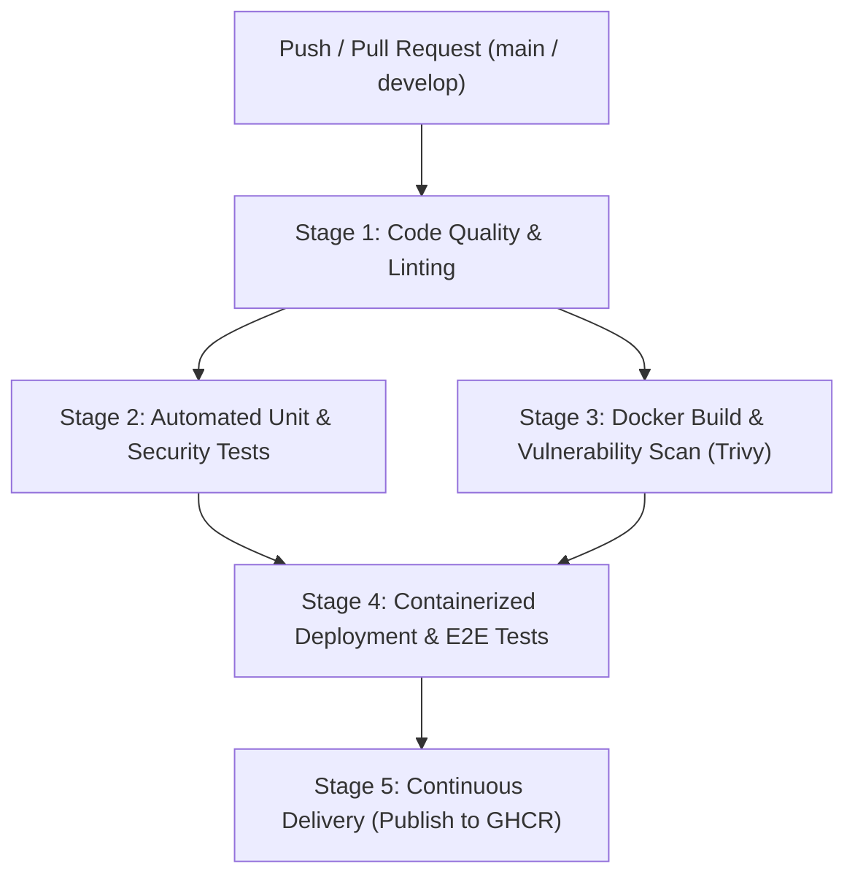

# 🚀 CI/CD Pipeline & Containerized Deployment Guide

This document provides a comprehensive inspection of the **BankOfCaptcha** platform architecture, followed by detailed documentation of the newly implemented **CI/CD Pipeline** and containerized deployment workflow.

---

## 🏗️ 1. Complete Project Architecture Inspection

BankOfCaptcha is a multi-tier, quantum-resistant, and AI-defended core banking platform. The project is structured into 4 decoupled, containerized tiers orchestrated via Docker Compose:

```
bankofcaptcha2/
├── .github/workflows/
│   └── ci-cd.yml                # Enterprise GitHub Actions 5-Stage CI/CD Pipeline
├── backend/                     # Java 17 / Spring Boot 3.2.4 API
│   ├── Dockerfile               # Multi-stage build (maven:3.9.6 -> eclipse-temurin:17-jre)
│   ├── pom.xml                  # Maven configuration with Spring Boot, PQC & testing deps
│   ├── src/main/java/...        # REST controllers, JWT filter, PQC & Risk Engine services
│   └── src/test/java/...        # JUnit 5, MockMvc & PQC cryptographic test suites
├── frontend/                    # React 19 / Vite SPA
│   ├── Dockerfile               # Multi-stage build (node:20-alpine -> nginx:alpine)
│   ├── package.json             # NPM package manifest with build, lint, and test scripts
│   ├── nginx.conf               # High-performance Nginx configuration with cache controls
│   └── src/...                  # Responsive UI dashboards for 6 distinct user roles
├── ai/                          # Python 3 / PyTorch LSTM Behavioral AI Engine
│   ├── Dockerfile               # Python 3.10 slim container with PyTorch CPU
│   ├── requirements.txt         # Dependencies (torch, apscheduler, pandas, numpy, requests)
│   ├── inference.py             # 4-signal behavioral anomaly fusion engine
│   ├── main.py                  # Polling scheduler and anomaly ingestor
│   └── tests/test_ai_engine.py  # Unit tests for tensor shapes, model forward pass & registry
├── tests/
│   └── e2e_integration_test.py  # Automated End-to-End smoke & security verification suite
├── scripts/
│   ├── run_ci_cd_local.sh       # Local CI/CD pipeline simulator (runs all 5 stages locally)
│   └── deploy.sh                # Production/staging deployment with automated rollback
├── docker-compose.full.yml      # Orchestrates all 4 containers (PostgreSQL, Backend, Frontend, AI)
└── docker-compose.yml           # Standalone PostgreSQL service definition
```

### Component Breakdown
1. **Database Tier (`boc-postgres`)**:
   - PostgreSQL 16 Alpine with custom container healthchecks (`pg_isready`).
   - Default mapped port `5433:5432` to avoid host PostgreSQL port collisions.
2. **Backend API Tier (`boc-backend`)**:
   - Java 17 + Spring Boot 3.2.4 REST API layer.
   - Integrates NIST-standardized Post-Quantum Cryptography (**ML-DSA-65** for tamper-proof digital signatures and **ML-KEM-768** for AES-256-GCM quantum-resistant envelope encryption via Bouncy Castle PQC).
   - Dynamic Risk Engine for transaction approval and Maker-Checker compliance workflows.
3. **Frontend UI Tier (`boc-frontend`)**:
   - React 19 SPA built with Vite and hosted on Alpine Nginx.
   - Role-adaptive dashboard rendering specialized interfaces for 6 roles: Customer, Teller, Branch Manager, Compliance Officer, IT Admin, and Super Admin.
4. **AI Behavioral Engine Tier (`boc-ai`)**:
   - PyTorch LSTM Autoencoder performing continuous behavioral biometric analysis.
   - 4-Signal fusion engine: LSTM sequence anomalies, role-action violation detection, statistical transaction profiling (Z-scores), and temporal anomalies.
   - Automatically posts high-risk anomaly alerts to the backend, auto-freezing compromised user sessions.

---

## 🔄 2. CI/CD Pipeline Architecture (`.github/workflows/ci-cd.yml`)

The CI/CD pipeline is designed according to enterprise standards for containerized applications, executing 5 sequential and parallel stages:



### Stage 1: Static Analysis, Linting & Configuration Validation
* Validates Docker Compose files (`docker compose config`).
* Compiles and checks Java code quality (`mvn clean test-compile`).
* Runs frontend linter (`oxlint`).
* Verifies Python syntax across all scripts and test suites (`py_compile`).

### Stage 2: Automated Unit & Cryptographic Test Suites
* **Backend**: Executes JUnit 5 and Spring Boot tests (`mvn test`), verifying:
  - `RiskEngineServiceTest`: Transaction threshold blocking and open-alert access containment.
  - `PqcAuditServiceTest`: Cryptographic sealing with ML-DSA-65 signatures, ML-KEM-768 key encapsulation, and rejection of tampered metadata.
  - `AuthControllerTest`: MockMvc authentication and JWT issuance.
  - `ApiApplicationTests`: Spring Boot application context verification.
* **Frontend**: Executes `npm run build` and bundle verification.
* **AI Engine**: Executes `unittest` verifying action registry mappings, configuration parameters, and LSTM Autoencoder forward tensor shapes.

### Stage 3: Multi-tier Container Build & Security Scan
* Builds Docker images for Backend, Frontend, and AI using Docker Buildx and GitHub Actions caching.
* Runs Aqua Security **Trivy** vulnerability scanning against the container images to identify CVEs before deployment.

### Stage 4: Containerized Stack Deployment & E2E Integration Tests
* Deploys the complete 4-tier stack using `docker compose -f docker-compose.full.yml up -d --build`.
* Performs readiness probing until PostgreSQL, Spring Boot, Nginx, and Python AI are all healthy.
* Executes the automated E2E test suite (`tests/e2e_integration_test.py`):
  1. Multi-role authentication & JWT verification.
  2. PQC audit log verification with ML-DSA-65 signature checking.
  3. AI alert ingestion via secured `X-AI-Service-Key` endpoint.
  4. Zero-Trust Risk Engine user containment verification.
  5. Frontend responsive HTML & bundle delivery check.
* Automatically collects container logs and uploads artifacts on test failure.
* Performs clean container teardown.

### Stage 5: Continuous Delivery (Publish to Container Registry)
* Triggers automatically upon merging to the `main` branch.
* Authenticats to GitHub Container Registry (`ghcr.io`).
* Tags and pushes versioned images (`:latest` and `:<commit-sha>`) for Backend, Frontend, and AI.

---

## 🛠️ 3. How to Run the Pipeline

### Option A: Local CI/CD Simulation (1-Command Verification)
You can run the entire CI/CD pipeline locally before committing to verify all stages pass:

```bash
cd /home/shreshtha-kumar/Desktop/Projects/FinSparkv4/bankofcaptcha2
./scripts/run_ci_cd_local.sh
```

### Option B: Production Deployment
To deploy or update the containerized application stack to staging or production:

```bash
cd /home/shreshtha-kumar/Desktop/Projects/FinSparkv4/bankofcaptcha2
./scripts/deploy.sh production
```

### Option C: Triggering via GitHub Actions
To trigger the automated GitHub Actions pipeline:
1. Stage all changes: `git add .`
2. Commit: `git commit -m "feat: implement multi-tier CI/CD pipeline and containerized deployment"`
3. Push to your repository: `git push origin main`
4. View the live execution in the **Actions** tab on GitHub:
   `https://github.com/Shreshtha-Kumar/bankofcaptcha2/actions`

